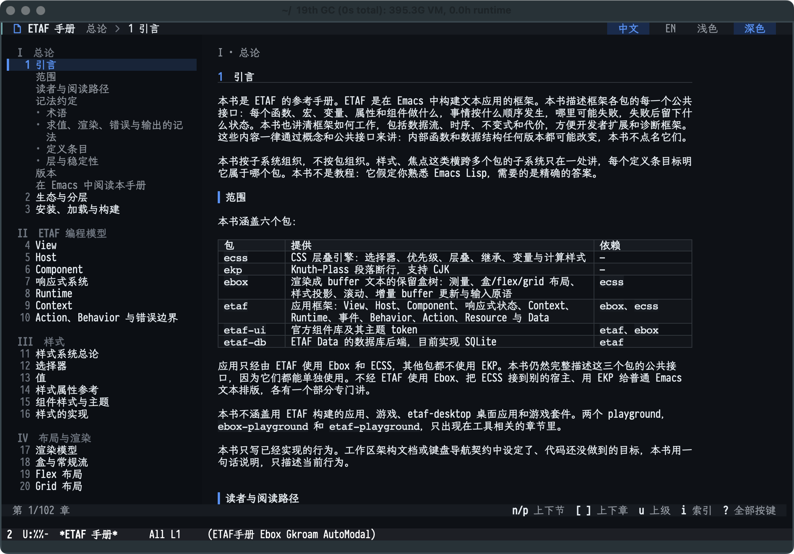
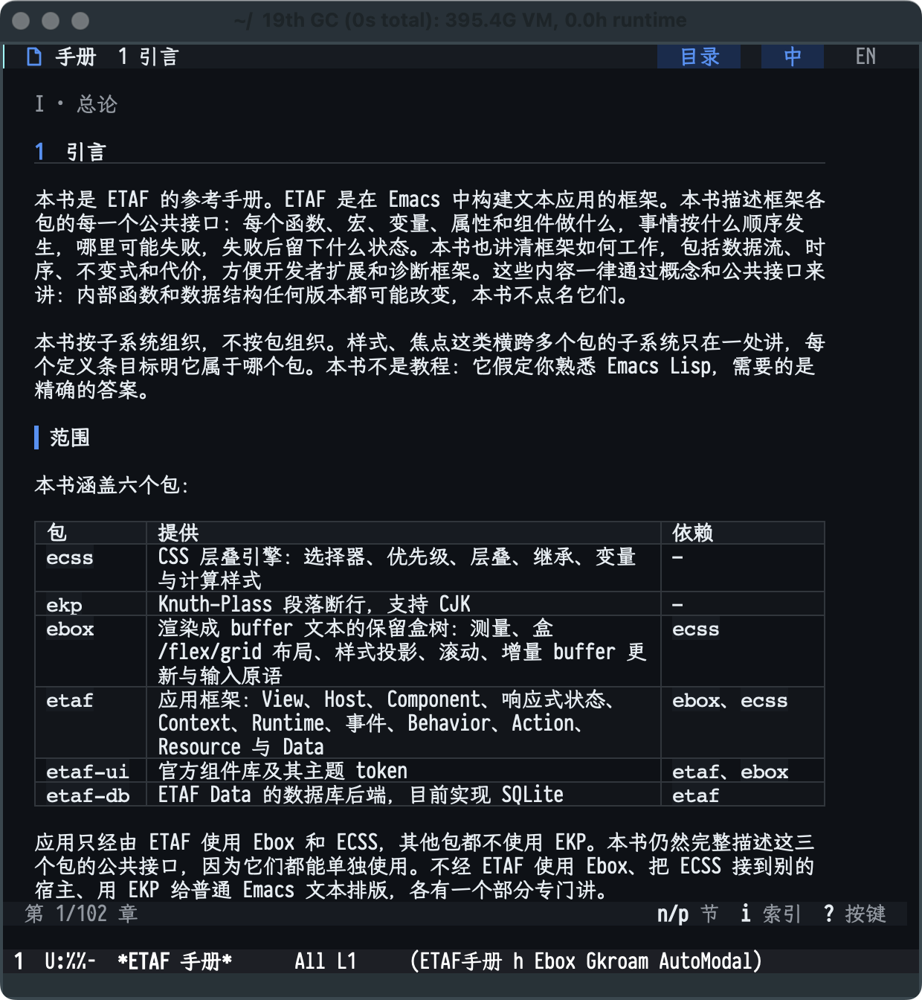

# ETAF Reference Manual

[中文](README.zh-CN.md)

The ETAF Reference Manual documents every public interface of the core ETAF packages: ecss, ekp, ebox, etaf, etaf-ui and etaf-db. Like the Emacs Lisp Reference Manual, it is organized by subsystem and object, gives one definition entry for each public function, macro, variable, hook, error, component, Host, property, style property and theme token, and explains how each subsystem works through concepts and public interfaces. It is written in English and Simplified Chinese.

This repository holds the book source, the `etaf-manual` package, which reads the book as data for Emacs tools and the site build, and the Emacs reader application built with ETAF itself. The book is checked against the code: a build fails when a signature differs from its package's Commentary, when the text names a symbol that is not public, when a stated version is out of date, when a translation diverges, or when a runnable example fails to mount.

The book is complete: 89 chapters in twelve parts, appendices A-K, the concept index and the symbol index, in both languages. `M-x etaf-manual-open` opens it in Emacs; the HTML edition is not implemented yet.

## Requirements

Emacs 29.1 or later, ETAF 0.2.1 and etaf-ui 0.1.0. The gate also reads the ecss, ekp, ebox, etaf, etaf-ui and etaf-db checkouts, which it expects next to this repository.

## Use

Add the repository root to `load-path`, together with ETAF and its dependencies, then require the package:

```elisp
(require 'etaf-manual)

(plist-get (etaf-manual-definition 'etaf-ref) :chapter)
     ⇒ reactivity
```

To read a chapter as Markdown, open its file below `book/en/` or `book/zh-CN/`; to read the manual as an application, use the reader below. The supported API is listed in the Commentary of [`etaf-manual.el`](etaf-manual.el).

## Reading the manual in Emacs

`M-x etaf-manual-open` opens the manual in its own buffer, built with ETAF itself. The reader shows a navigation column with the three-level outline, the article with definition cards and runnable examples, a header with the reading position and the language and palette switches, and a key-hint footer. Every line keeps the standard line height, so scrolling never shifts the layout; a narrow frame collapses the navigation column into an overview screen.





- `n` / `p` move between sections, `u` goes one level up, `l` / `r` walk the reading history.
- `[` / `]` change chapter, `i` opens an index of terms and definition entries, `g` switches between Chinese and English, `t` switches the palette, `q` closes the reader.
- `?` opens the ETAF key help listing the reader's keys with their labels.
- `TAB`, the arrows, `RET`, `M-g` and `Escape` keep the framework behaviours, so controls inside runnable examples stay focusable and operable.

Every `elisp :run` example renders in place. Its viewer card offers *source*, *preview* and *side-by-side* modes, a run/rerun control and a stop control; the preview is the real, interactive ETAF View the example builds, not a screenshot.

`M-x etaf-manual-lookup` opens the manual at a symbol's definition entry from any buffer.

## Documentation

- [Writing the manual](docs/manual.md): the book format, the gate and the commands.
- [Introduction](book/en/introduction.md): the scope of the book and its notation.

## Development

Run `make setup-hooks` after cloning. `make book-check` runs the gate, `make coverage` prints how many interfaces of each package have an entry, and `make check` adds structure, compilation, the public scenarios in [tests/acceptance.json](tests/acceptance.json), the API boundary check and the gate's tool tests.
